# HL Coordenadas

Sistema interno de localizacao de estoque e conferencia digital de notas fiscais.
Os dois modulos rodam no mesmo processo Windows e abrem no navegador. V7.2.

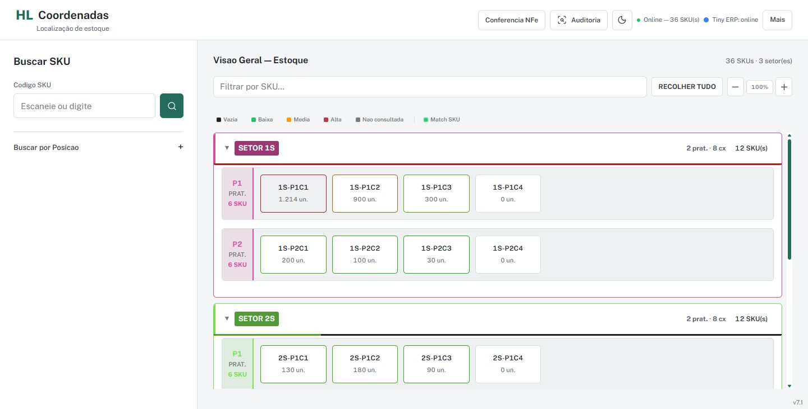

## O que esta integrado

| Area | Recursos |
| --- | --- |
| Coordenadas | Busca de SKU, cadastro/movimentacao, operadores lembrados, setores com cores fixas, caixas retangulares e ocupacao por borda |
| Consulta da caixa | SKU e nome na mesma linha, unidades disponiveis e resumo de vendas, com atualizacao sob demanda |
| Auditoria | Pesquisa por SKU, estado atual no Supabase, posicao no Tiny e linha do tempo com origem, operador e horario |
| Mapas | Ocupacao por caixa/setor e vendas dos SKUs atualmente em cada caixa |
| Conferencia NFe | PDFs de uma pasta local, autocomplete com setas, grifos, quantidades, historico, desfazer, reset com confirmacao e PDF final |
| Impressao | Modelo de etiqueta existente, impressora Windows configuravel e runtime local verificado por SHA-256 |

## Duas Edicoes

As duas incluem Coordenadas e Conferencia NFe. Use somente uma por PC.

- **Publicador**: destinado ao PC com autorizacao Tiny para consultar logs de estoque e publicar o resumo agregado no Supabase.
- **Leitor**: consulta o resumo compartilhado sem login no Tiny; nao inclui a chave do publicador e ignora chaves de publicacao locais antigas.

"Leitor" se refere ao resumo de vendas, nao a um bloqueio geral de edicao do estoque.
Atualizar o estoque da caixa, enviar localizacao e imprimir etiquetas exigem
autorizacao Tiny propria. Ler unidades e vendas ja compartilhadas nao exige login Tiny.
O Publicador nao leva access/refresh tokens de outro PC: a autorizacao acontece no destino.

**Mais > Atualizar vendas** mostra o andamento da publicacao por SKU: consulta,
calculo, envio e confirmacao do Supabase, com contadores de sucessos/falhas e filtro
por SKU. O envio e imediato por SKU, nao apenas ao fim do lote. Os ultimos 100
eventos da execucao ficam visiveis e sao lembrados ao reabrir o Publicador;
o SQLite local guarda ate 2000 eventos. Esses logs sao somente de vendas.

Se uma saida nao puder ser interpretada, use **Mais > Atualizar vendas**, digite
o SKU em **SKU com erro** e clique **Baixar diagnostico** no PC autorizado. A
consulta le apenas uma pagina de 20 movimentos, nao publica vendas nem altera
produtos. O JSON inclui nomes de campos, estrutura e valores numericos de
quantidade/preco; credenciais, textos livres e identificadores sao removidos.
Falhas de interpretacao tambem preservam uma amostra sanitizada no SQLite local
`sales_diagnostics` (ate 10 SKUs). Nao trate essa amostra como historico completo.

### O que significa VENDAS

Contagem de movimentos de **saida com valor positivo**, deduplicados por identificador.
Nao e contagem de pedidos unicos, valor financeiro ou quantidade de unidades.
O agregado tambem guarda as unidades e o periodo consultado.
Ausencia de resumo, falha e 403 **nao viram zero vendas**.

O mapa soma os resumos dos SKUs nas suas caixas **atuais**, nao nas caixas onde estavam
na data da venda. Rankings comparativos usam caixas com resumo completo.
Nenhuma importacao em massa comeca ao abrir o sistema. Os botoes de notas fiscais
para calculo de vendas estao ocultos; a consulta atual usa logs de estoque.

### Ocupacao por Unidades

Execute uma vez [supabase_ocupacao_unidades.sql](supabase_ocupacao_unidades.sql)
no SQL Editor do projeto. O script acrescenta dois campos e uma RPC; nao apaga
localizacoes, operadores ou historico existente.

O botao **Atualizar** da caixa consulta produtos/estoque por GET no Tiny e grava
somente as unidades disponiveis e a data da consulta no Supabase. A publicacao
exige estoque recente de todos os SKUs e a mesma composicao da caixa; falhas ou
movimentacoes concorrentes preservam os valores anteriores. Nenhum campo de
produto, custo, preco ou estoque e escrito no Tiny por essa consulta.

A borda usa a soma das unidades, nao a quantidade de SKUs. A escala e relativa
a maior caixa conhecida, nao uma porcentagem de capacidade fisica. Dados ainda
nao consultados ficam cinza. Nos mapas, e possivel alternar unidades, SKUs e vendas.
Vendas usam escala continua de vermelho (zero) a verde (maior valor); ocupacao usa
o sentido inverso. Filtrar um setor nao muda a referencia global da escala.

As animacoes respeitam a preferencia do sistema. **Mais > Animacoes** permite
ativar ou desativar explicitamente, com a escolha lembrada no navegador.

O mapa inclui **Atualizar todas as unidades**: operacao explicita em segundo plano,
sequencial e limitada pelo cliente Tiny. Consulta apenas produtos/estoque por GET,
sem recalcular vendas nem ler notas. Cada caixa completa e confirmada no Supabase
separadamente; uma falha nao publica zeros. O progresso e o ultimo lote completo
deste PC sao persistidos. As datas de unidades mais recente/antiga vem das linhas
compartilhadas no Supabase, independentemente de qual PC fez a consulta.

### Caixas Bloqueadas

Execute uma vez [supabase_bloqueio_caixas.sql](supabase_bloqueio_caixas.sql).
Ao abrir uma caixa, **Bloquear/Desbloquear** fica ao lado de Atualizar. O bloqueio
e compartilhado e impede cadastro ou movimentacao de novos SKUs para a caixa.
SKUs existentes podem continuar sendo atualizados ou retirados. Um trigger impede
a entrada mesmo por versoes antigas da interface. A interface atual mostra uma
mensagem junto de Salvar e treme sem popup; movimento reduzido usa apenas feedback
de opacidade. Falha ao consultar o bloqueio impede salvar ate confirmar o estado.

## Executar o Codigo

Requer Windows 64 bits e Python 3.14. Os executaveis prontos sao distribuidos
internamente, fora deste repositorio. Para desenvolver:

```powershell
python -m venv .venv
.venv\Scripts\Activate.ps1
python -m pip install -r requirements.txt
```

Crie `configuracao_privada/app_config.json` a partir de
`config/app_config.example.json`, com URL e chave **publica** do Supabase.
Tambem e possivel usar `HL_SUPABASE_URL` e `HL_SUPABASE_KEY`.
Nunca use `service_role` no frontend: a chave publica pode ser lida pelo navegador;
as permissoes precisam estar protegidas por RLS.

Para recursos Tiny, crie `tiny_v3_config.json` na raiz a partir do exemplo em
`config/`, usando o redirect cadastrado no aplicativo Tiny. Autorize pelo programa.
Nao versionar o arquivo nem os tokens gerados.

```powershell
python tools/prepare_ui.py
python unified_v7.py
```

- Coordenadas: `http://127.0.0.1:8766/`
- Conferencia: `http://127.0.0.1:8770/`
- Console: `TROCAR CHAVES`, `AUTORIZAR` e `SAIR`.

As portas sao locais. Nao publique estes servidores na internet: nao sao um produto
multiusuario com autenticacao propria. Nao use acesso de rede irrestrito para eles.

## Dados e Continuidade

| Conteudo | Local |
| --- | --- |
| Localizacoes, estrutura e historico compartilhado | Supabase |
| Resumo agregado de vendas | Supabase `resumo_vendas` |
| Unidades por SKU e data da consulta | Supabase `estoque.unidades_estoque` / `unidades_atualizadas_em` |
| Cache de consultas, auditoria e tokens do Leitor | `%LOCALAPPDATA%\HL_Coordenadas_V5` |
| Dados e tokens do Publicador | `%LOCALAPPDATA%\HL_Coordenadas_V5_Publicador` |
| Progresso da conferencia e configuracao da impressora | `%LOCALAPPDATA%\HL_Conferencia_NFe` |
| PDFs de entrada | Pasta escolhida nas configuracoes; padrao `Desktop\ETIQUETAS` |

Os nomes internos V5 foram preservados para nao perder dados das instalacoes antigas.
Pelo codigo-fonte, os dados de Coordenadas ficam na raiz, salvo se
`HL_COORDENADAS_DATA_DIR` for definido. Feche o programa antes de fazer backup do
SQLite; preserve tambem os PDFs originais. Trocar o EXE nao exige apagar bancos.

A V7.2 fecha a instancia HL anterior ao iniciar este EXE. Programas desconhecidos
nas mesmas portas nao sao encerrados. Evite trocar a versao durante uma impressao
ou cadastro pendente; consultas interrompidas preservam apenas o que ja foi salvo.

Para preparar o Supabase, consulte [Configuracao de vendas](CONFIGURAR_RESUMO_VENDAS.md)
e [Arquitetura e operacao](docs/ARQUITETURA.md). SQLs sao executados manualmente pelo
administrador do projeto, nao automaticamente ao abrir o programa.

## Compilar

Prepare os quatro arquivos privados indicados em `config/`: o exemplo Tiny vai para
`tiny_v3_config.json`, e os outros tres para `configuracao_privada/`, sem `.example`.
O script baixa o pacote oficial SumatraPDF caso falte e prepara os assets offline.

```powershell
.\tools\build_v7.ps1
```

Se a politica do Windows bloquear scripts PowerShell, nao e preciso altera-la:
prepare o ZIP oficial indicado em `HL_Conferencia_NFe/tiny_print.py`, depois rode
`python tools/prepare_ui.py` e `python -m PyInstaller --noconfirm HL_Coordenadas_V7.spec`.

Saidas locais em `dist/`: `HL_Coordenadas_Publicador_V7.exe` e
`HL_Coordenadas_Leitor_V7.exe`. **Nao publicar esses arquivos no GitHub.**
O Publicador contem uma chave extraivel de publicacao: distribua apenas ao PC
autorizado. Executaveis nao sao cofres de segredos.

## Testes

```powershell
python -m unittest discover -s tests -p "test_*.py"
node --test tests/test_count_queue.cjs tests/test_warehouse_metrics.cjs
python tools/demo_server.py
```

A demo abre em `http://127.0.0.1:18866/` e `/conference`. Ela nao importa os
clientes Tiny/Supabase e usa apenas dados sinteticos. Todas as imagens abaixo foram
capturadas nessa demo, sem nomes de clientes, chaves, notas ou estoque reais.
Os testes automatizados usam clientes simulados e bancos temporarios.

## Telas

<details><summary>Coordenadas: tema escuro, busca e caixa</summary>

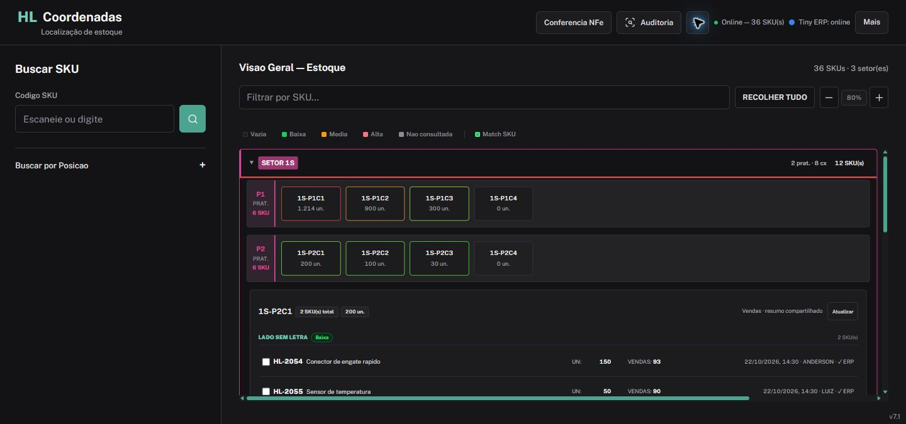
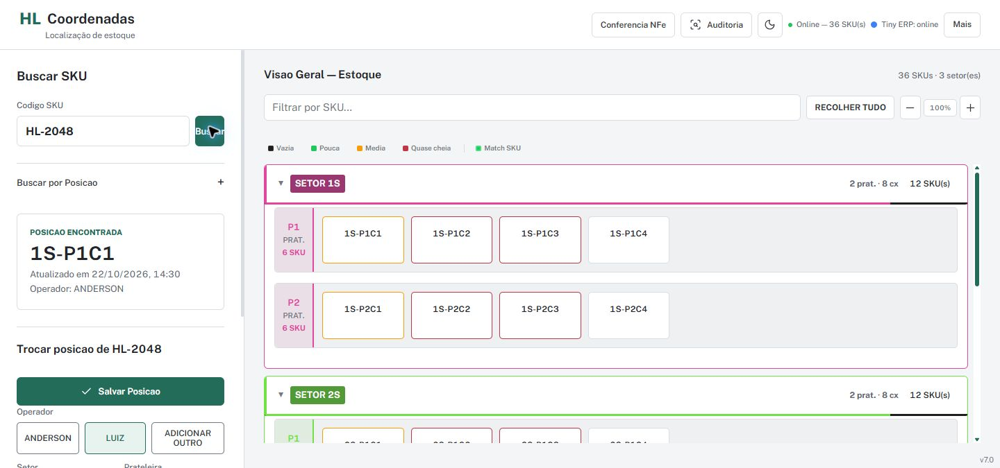
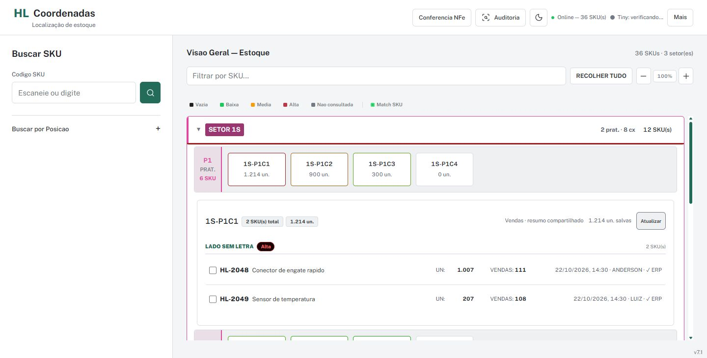

</details>

<details><summary>Mapas e auditoria</summary>

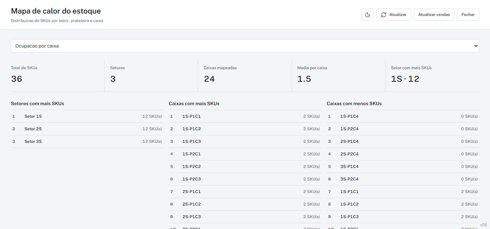
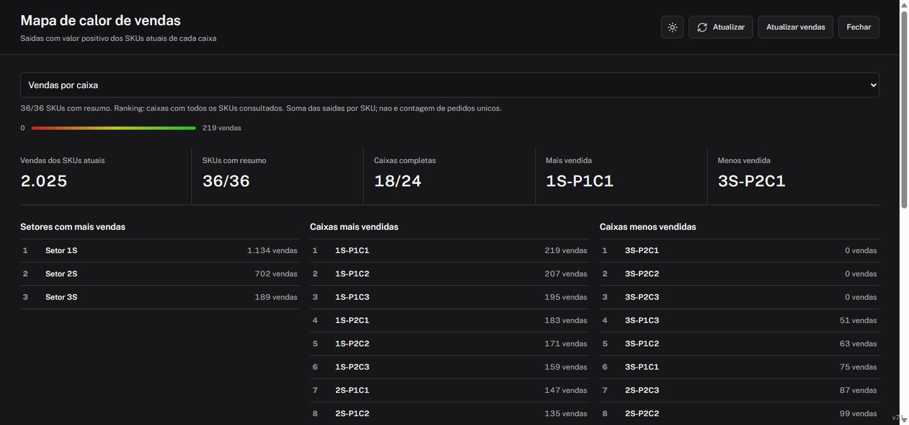
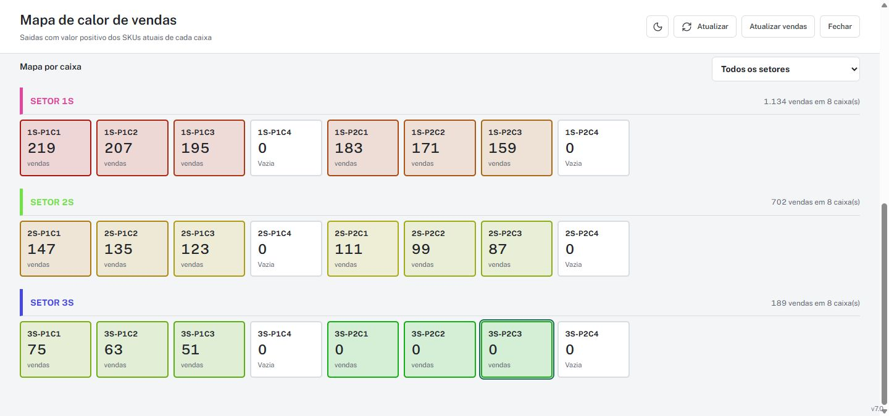
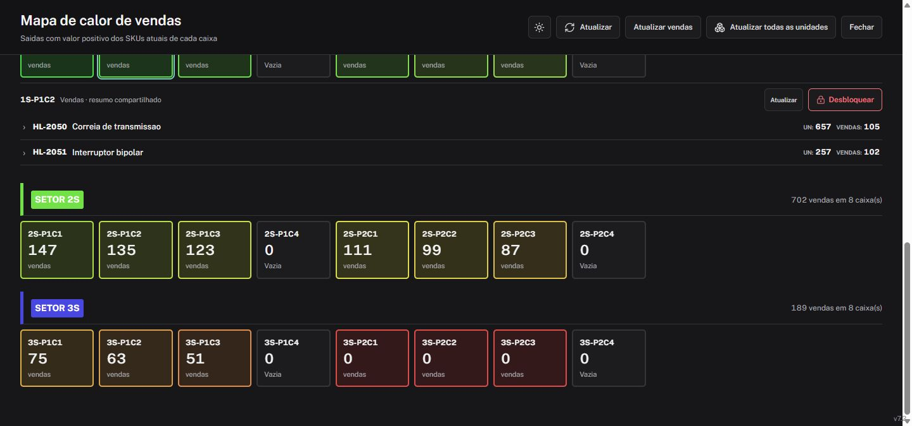
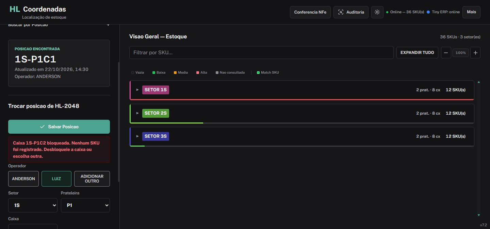
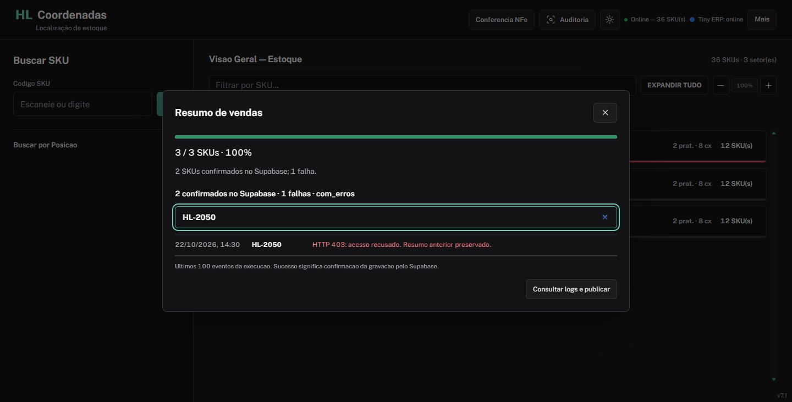
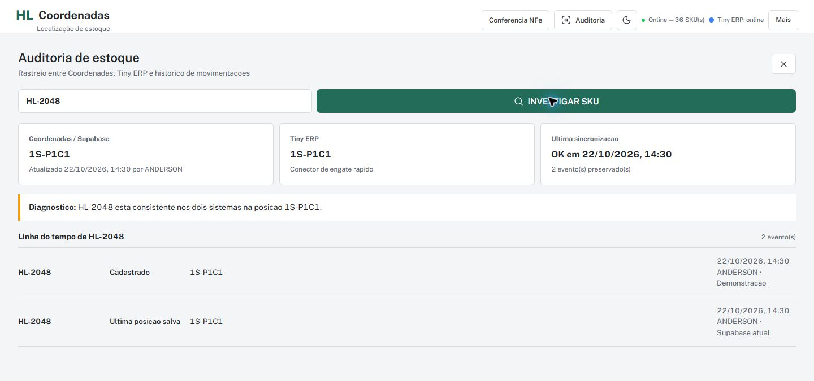
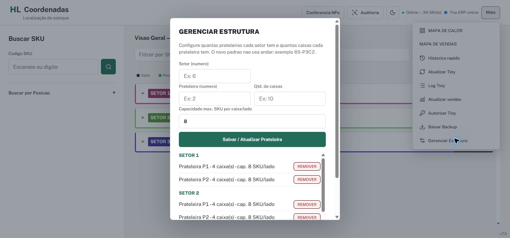

</details>

<details><summary>Conferencia: claro, escuro e autocomplete</summary>

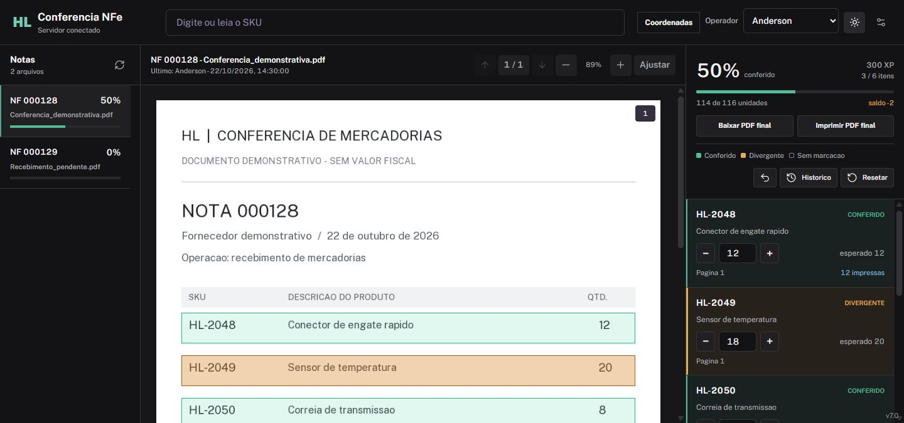
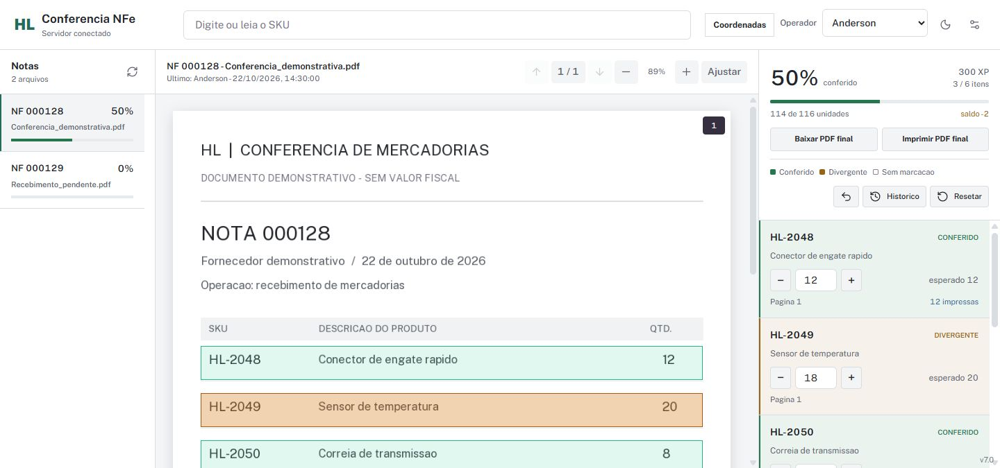
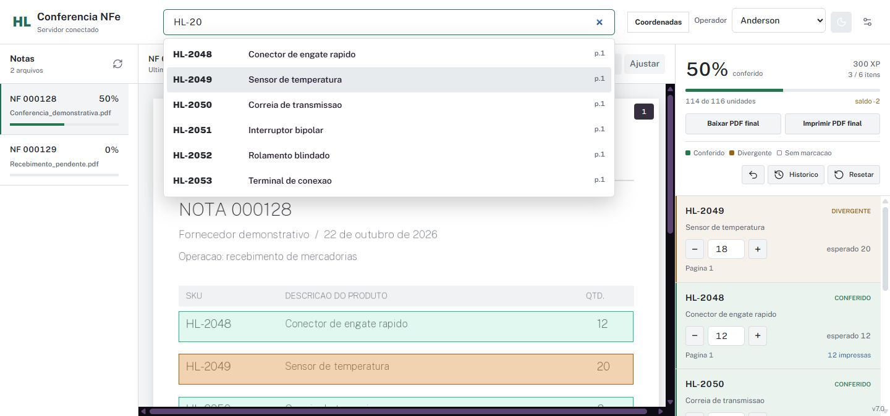

</details>

<details><summary>Historico, impressora e confirmacao de reset</summary>

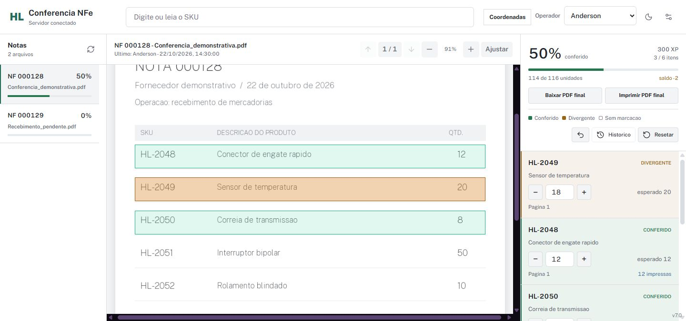
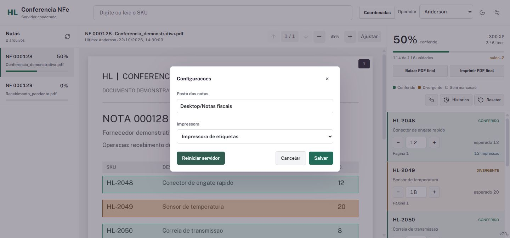
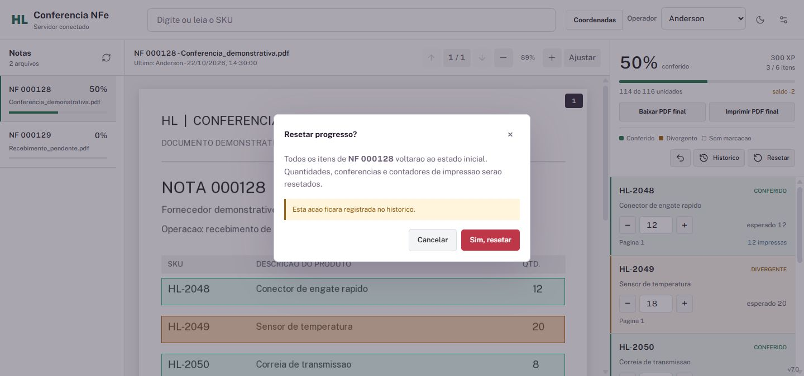

</details>

<details><summary>Layouts compactos</summary>

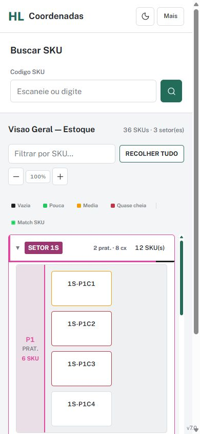
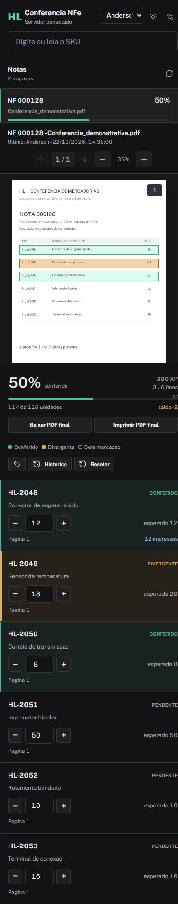

</details>

## Desenvolvimento e Seguranca

Veja [decisoes da V7, validacao e hipotese de commit](docs/DESENVOLVIMENTO.md).
Antes de qualquer commit, execute `python tools/security_check.py` depois de revisar
o staging. O verificador bloqueia artefatos privados e padroes de credenciais, sem
imprimir os seus valores. Isso complementa, nao substitui, a revisao humana.

Public Sans (OFL) e Lucide (ISC) sao incluidos com suas licencas em `ui/`.
Avisos do runtime de impressao: `HL_Conferencia_NFe/THIRD_PARTY_NOTICES.txt`.
